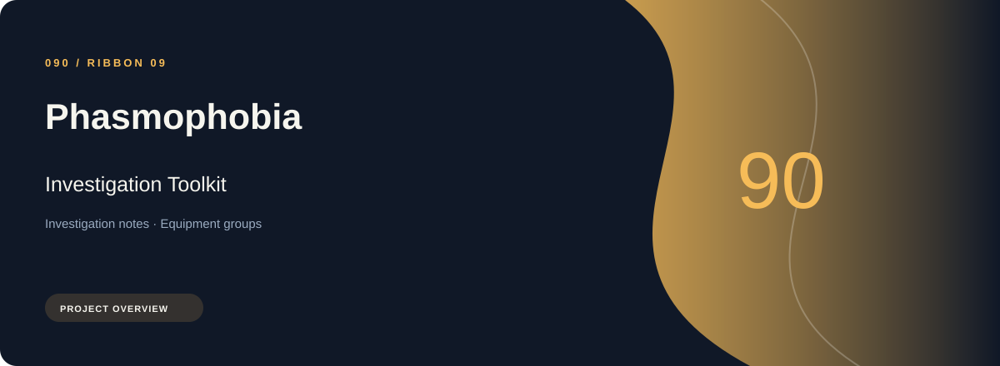
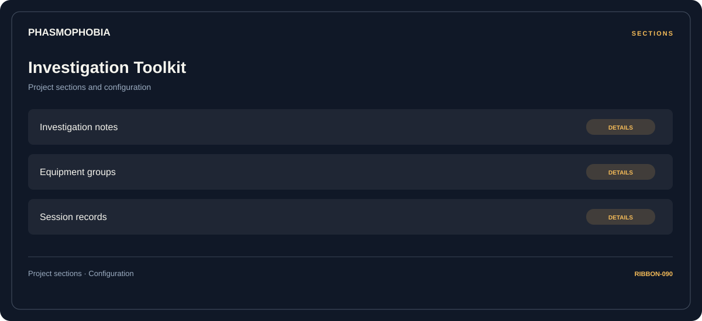

# ⚡ Phasmophobia Investigation Toolkit

**Investigation notes · Equipment groups · Session records**

## ⚡ Features

A task-oriented Phasmophobia investigation toolkit workspace: investigation notes first, equipment groups next, and session records as the final reference area.

### ⚙️ Investigation notes

A dedicated section for investigation notes and the configuration details associated with that area.

### 🧩 Equipment groups

Equipment categories and the associated selection or configuration options.

### ⌨️ Session records

Session and activity information grouped by the task or context it belongs to.

## 🖥️ Project navigation

## 📥 Download

The button and cover open the project's download page. Use the information supplied with the downloaded package for installation and release-specific requirements.

## 📚 Project documentation

- [Feature reference](docs/FEATURES.md)
- [Download information](docs/DOWNLOAD.md)
- [Project page](index.html)

---

Phasmophobia Investigation Toolkit · Program documentation and download information.
